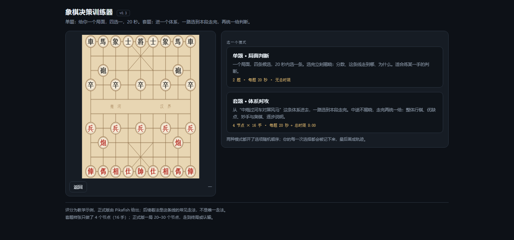

# 象棋决策训练器

**把「看棋」改成「每手做一次选择，然后立刻知道自己差在哪」。**

一个单文件网页原型，零依赖，双击即开。它不是引擎——不给「这步该走哪」的答案，问的是「走这里会进入什么样的棋」。

**[→ 在线试玩](https://ass1st.github.io/xiangqi-coach/)**（或下载 `index.html` 直接双击）



---

## 为什么做这个

引擎给分数不给计划，棋书给计划但不针对你眼前的局面。**中间这一层是空的**——业余棋手大多知道该走哪，但不知道为什么走那里更好下，也不知道走别处会进入什么局面。

这个原型只做一件事：把「分支 → 体系 → 局面性质 → 三条典型计划」讲成能选、能判、能复盘的题目。

## 三种玩法

| 玩法 | 入口 | 时间 | 揭晓时机 |
|---|---|---|---|
| 单题 | 一个局面 | 20 秒 / 题 | 选完立刻揭晓：分数、这条线走到哪、为什么 |
| 套题 | 进一个体系（中炮过河车对屏风马，4 节点 16 手） | 20 秒 / 题 + 总时限 8:00 | 中途不揭晓，本段走完统一给 |
| 自由训练 | 不测评，直接练 | 不限 | 不给分 |

四条固定规则：

1. 永远四选一
2. 选项每次随机排序（防止第二遍背答案）
3. 选之前不给任何分数、标签、讲解——先答后判
4. 每一次选择都记进轨迹（选了什么 / 最佳是什么 / 得几分 / 用了几秒），轨迹是诊断的原料

## 五个能力环

| 环 | 测法 |
|---|---|
| 开局 | 给 8 个局面，问「属于哪个体系、下一步主流是什么」 |
| 审局 | 给 10 个局面，问「谁好、好多少、朝哪边走」 |
| 战术 | 10 道 3 步内战术题（弃子、牵制、闪击、封锁） |
| 算度 | 8 道强制变化题，限时 |
| 残局 | 8 道定式与杀法 |

## 收尾三报

一次训练结束，先报三件事，三句报完再展开：

1. **报现状**：得分 X / 满分 Y，踩中最佳 N / M 手，停在哪一手
2. **报预期**：按这条体系的标准走法，这些手应得多少（**必须给基线**，不给形容词）
3. **报差距**：差几分、做到几成、差在哪一手，附一句可验证的归因（次序问题 / 没看见对方威胁 / 兑子取舍错）

三报之后才展开整体说明（含**妙手**＝这局走得最好的一手、**臭棋**＝最差的一手）与逐步说明（每手「你选的 / 最佳 / 得分 / 为什么」，可跳过）。

反例（明确不做）：只给分数不给基线；用「下得不错」这类评价代替数字；先铺逐步讲解最后才报总分。

## 代码在做什么

单文件 `index.html`，约 1000 行，没有构建步骤：

- **棋盘渲染**：canvas 9×10，坐标映射，河界与九宫斜线，上一手双框标记
- **着法数据**：开局布阵 + 主线着法数组 + 分岔点索引；到分岔点弹三路候选
- **局面回滚**：每步存快照，可以真的走进分支再退回，不是只看文字
- **双计时器**：单题 20 秒 / 套题总时限 8:00，都带进度条与临界变色
- **轨迹与总评**：每次选择落一条记录，结束时算得分率、踩中率，定位妙手与臭棋

分支合法性做过校验：32 子无叠子、吃子数与预期一致、相邻节点主线连续。

## 边界（写死）

- **分数是教学示例，不是引擎算的。** 正式版接皮卡鱼出真分。
- **不做局内实时支招。** 真人平台封号；本产品只做赛后复盘、AI 对练、录谱分析。
- **24 条原型库（8 体系 × 3 原型）是产品资产，不在本仓库。** 这里放代码与框架，不放题库。
- 已知局限：套题样张只 4 节点（正式版应 20–30 节点走到终局）；单题仅 2 题，正式版按能力项组卷；两套卷难度未校准。

## 目录

```
index.html          全部代码（棋盘 / 交互 / 计时 / 总评）
README.md           本页
docs/01-设计决策.md  为什么这么设计、踩过什么坑
LICENSE             MIT
```

## 许可

- **代码**：MIT，随便用、随便改，保留版权声明即可。
- **文档与讲解文案**：CC BY-NC-ND 4.0，可读可引用，不可商用、不可改编。

---

首发于 github.com/ass1st/xiangqi-coach · 2026-11
